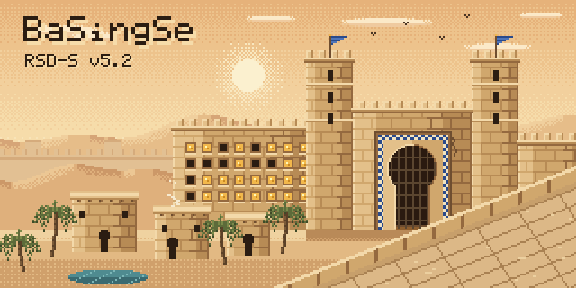

<p align="center">
  <picture>
    <source media="(prefers-color-scheme: dark)" srcset="assets/derivados/cabecalho-readme-noite-640x320.png">
    
  </picture>
</p>

# BaSingSe

**A cryptanalysis lab for RSD-S v5.2, an experimental symmetric primitive. A wall proves itself when exposed to fire.**

[](https://github.com/daniloludgero/CryptographyBaSingSe/actions/workflows/ci.yml)
[](LICENSE)


> **Research prototype. Do not use in production.** RSD-S has had no independent audit, has no FIPS validation and has no security proof. The source code is available for study and research, but this is **not an open-source license**: commercial use requires a license from the author ([`COMMERCIAL.md`](COMMERCIAL.md)).

[Português](README.md)

## Status of guarantees

| Guarantee | Status |
|---|---|
| Independent audit | **None** |
| FIPS validation | **No** |
| Formal security proof | **Conditional draft**, written for v5.1 and not yet updated to v5.2 ([`REDUCAO_QROM_RASCUNHO_V5_1.md`](especificacao/REDUCAO_QROM_RASCUNHO_V5_1.md)). It does not certify post-quantum security |
| Internal offensive review (red team) | 9 findings. The 2 **High** and 3 **Medium** findings were fixed in v5.2. Of the 4 **Low**: 1 dissipates after round 1, 1 is mitigated by the round key, 1 received range validation and **1 remains open** (L1D cache footprint and partial clearing of AVX2 registers) |
| Peer review | **Pending** |

Details, and what each line does **not** guarantee: [`docs/evidencia/GARANTIAS_E_LIMITES.md`](docs/evidencia/GARANTIAS_E_LIMITES.md) (Portuguese).

## What it is

RSD-S mixes a 512-bit state (32 words of 16 bits in GF(2^16)) over 8 rounds. Each round applies an inversion S-box with an affine layer, a 32×32 Cauchy MDS matrix and a round key derived with HMAC-SHA256. The repository contains the Python and C99 (AVX2) reference implementations, the frozen test vectors, SAT/SMT models and the cryptanalysis reports, including those that show where the construction fails at few rounds.

```text
(x, y) ──split──▶ 32 words ──⊕ rk0──▶ [ S-box ⊕ rc  →  MDS 32×32  →  ⊕ rk_r ] × 8
                                                              │
   two streams A and B (Anti-DFA), compared at the end ◀──────┘
                                                              ▼
                              SHA-256 (32 B)  or  SHAKE256 (64 B)  ──▶  output
```

Full specification (Portuguese): [`especificacao/ESPECIFICACAO_V5_2.md`](especificacao/ESPECIFICACAO_V5_2.md).

## Quick start (60 seconds)

```bash
git clone https://github.com/daniloludgero/CryptographyBaSingSe.git
cd CryptographyBaSingSe
pip install -r requirements.txt
python3 ferramentas/rsd_cli.py kat52
```

The last command checks the 6 frozen v5.2 vectors. For the full deterministic suite:

```bash
python3 -m unittest discover -s testes -p "test_*.py"
```

`testes/test_vetores_v52.py` also compiles the C99 core and checks bit-for-bit parity with Python, so it needs `gcc`.

## Verified results and what they do **not** show

| Result | What it does **not** show |
|---|---|
| **v5.2 vectors**: 6 vectors and 120 random inputs with C99 × Python parity (126 of 126) in three builds, and 24 of 24 injected faults detected ([`testes/vetores_v52.json`](testes/vetores_v52.json)) | That the construction is secure. It shows two implementations agree with each other |
| **Wide-trail**: at least 66 active S-boxes over 4 rounds and 132 over 8; single-characteristic differential bound 2^-1848 | It does not sum trails and is not a security proof |
| **Constant time** (v5.2): TVLA with 100,000 samples per group; max \|t\| 2.30 over 12 runs, the same order as the random-vs-random control (2.18); threshold 4.5; `-O3 -mavx2` | Absence of leakage on another CPU or compiler. The measurement VM is noisy, which limits sensitivity |
| **Speed** (v5.2): 29.6 µs per call of the 8-round AVX2 core (≈ 2.06 MiB/s). Anti-DFA costs 1.95× (15.2 µs with a single stream) | Holds for one 2.10 GHz Xeon VM. It is the SPN core, without HMAC or the final hash. The Python reference takes ≈ 78 ms |
| **NIST SP 800-22** (re-run on v5.2): 10 of 10 core and 12 of 12 extended tests on 1,024,000 bits of the 64-byte serialization | The data are synthetic uniform vectors passed through the v5.2 folding function, not the end-to-end engine. Statistical sanity, not security |

Method, environment, limits and the reproduction command: [`docs/evidencia/MEDICOES_V5_2.md`](docs/evidencia/MEDICOES_V5_2.md) (Portuguese). Raw data in [`resultados/v5_2/`](resultados/v5_2/).

## Reduced-round versions already broken

RSD-S does not hide where it fails. With few rounds, structural attacks work: with the pre-SHA output observable, a Square/Integral attack recovers 512 bits of the equivalent 3-round subkey with 131,072 chosen plaintexts in about 10 seconds (reproduced on v5.2: [`ataque_square_3r.py`](ferramentas/medicao_v52/ataque_square_3r.py)). With 4 rounds the integral property disappears, and the public API hides the pre-SHA state. The official version uses 8 rounds. See [`docs/evidencia/COBERTURA_DE_CRIPTOANALISE.md`](docs/evidencia/COBERTURA_DE_CRIPTOANALISE.md) and the [public challenge](docs/DESAFIO.md).

## Comparison with AES

A harness of 5 automated attacks ran on AES-128, AES-256 and RSD-S v5.2 with the same tools. The maximum number of rounds at which the attack works:

| Attack in the harness | AES-128 (10R) | AES-256 (14R) | RSD-S v5.2 (8R) |
|---|---:|---:|---:|
| Integral / Square | 3R | 3R | 2R |
| Differential and truncated | 2R | 2R | 1R |
| Linear / Walsh (generic masks, same N) | 1R | 1R | 0R |

**Read with care.** This reach measures what the harness detects, not security. AES has over 25 years of public cryptanalysis, known attacks stronger than the harness and hardware acceleration. RSD-S has 8 rounds and no external review. With masks designed for the MDS structure, RSD-S is detected at 1R in the linear test. Method and source: [`docs/evidencia/MEDICOES_V5_2.md`](docs/evidencia/MEDICOES_V5_2.md) (Portuguese).

## Security

Implementation or supply-chain vulnerabilities: private report, per [`SECURITY.md`](SECURITY.md). Findings against the construction itself are welcome as public issues: see the [challenge](docs/DESAFIO.md).

## License and commercial use

The source code uses the [PolyForm Noncommercial 1.0.0](LICENSE) license.

- **No need to ask:** study, research, personal use and use by educational, research and public-interest institutions, under the license terms.
- **Needs a license from the author:** any commercial use, integration into a product or service, offering it as a hosted service. No one may commercialize this work without the written authorization of Danilo Ludgero. See [`COMMERCIAL.md`](COMMERCIAL.md).
- Earlier versions (v0.4.0 to v0.5.2) were released under the MIT license. That grant remains valid for those who obtained them ([`NOTICE`](NOTICE)).

## Contributing and citing

Contributions go through a contributor license agreement ([`CLA.md`](CLA.md)); see [`CONTRIBUTING.md`](CONTRIBUTING.md). To cite, use [`CITATION.cff`](CITATION.cff) (GitHub offers a "Cite this repository" button).

## History

The primitive started as a linear transformation (v0) and went through diagnostic versions up to v4. Then came v5.0, v5.1 and v5.2, each fixing flaws found by the project's own attacks. The full story, mistakes included, is in [`docs/historia/RELATORIO_FINAL.md`](docs/historia/RELATORIO_FINAL.md) (Portuguese).

---

Author and rights holder: **Danilo Ludgero**. © 2026. See [`NOTICE`](NOTICE).
