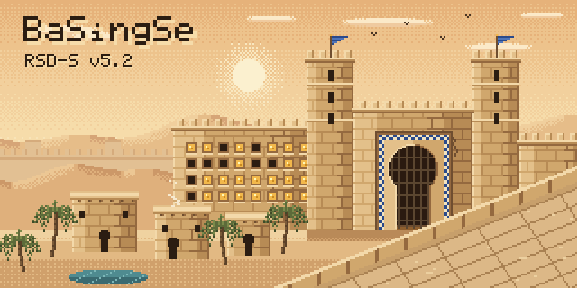

<p align="center">
  <picture>
    <source media="(prefers-color-scheme: dark)" srcset="assets/derivados/cabecalho-readme-noite-640x320.png">
    
  </picture>
</p>

# BaSingSe

**Laboratório de criptoanálise para a RSD-S v5.2, uma primitiva simétrica experimental. A muralha se prova, quando exposta ao fogo.**

[](https://github.com/daniloludgero/CryptographyBaSingSe/actions/workflows/ci.yml)
[](LICENSE)


> **Protótipo de pesquisa. Não use em produção.** A RSD-S não teve auditoria independente, não tem validação FIPS e não tem prova de segurança. O código-fonte está disponível para estudo e pesquisa, mas esta **não é uma licença open source**: uso comercial exige licença do autor ([`COMMERCIAL.md`](COMMERCIAL.md)).

[English](README.en.md)

## Estado das garantias

| Garantia | Estado |
|---|---|
| Auditoria independente | **Nenhuma** |
| Validação FIPS | **Não** |
| Prova formal de segurança | **Rascunho condicional**, escrito para a v5.1 e ainda não atualizado para a v5.2 ([`REDUCAO_QROM_RASCUNHO_V5_1.md`](especificacao/REDUCAO_QROM_RASCUNHO_V5_1.md)). Não certifica segurança pós-quântica |
| Revisão ofensiva interna (red-team) | 9 achados. Os 2 de severidade **Alta** e os 3 **Médios** foram corrigidos na v5.2. Dos 4 **Baixos**: 1 se dissipa na 1ª rodada, 1 é mitigado pela subchave, 1 recebeu validação de faixa e **1 segue aberto** (pegada de cache L1D e limpeza parcial de registradores AVX2) |
| Revisão por pares | **Pendente** |

Detalhes e o que cada linha **não** garante: [`docs/evidencia/GARANTIAS_E_LIMITES.md`](docs/evidencia/GARANTIAS_E_LIMITES.md).

## O que é

A RSD-S mistura um estado de 512 bits (32 palavras de 16 bits em GF(2^16)) por 8 rodadas. Cada rodada aplica uma S-box por inversão com camada afim, uma matriz MDS de Cauchy 32×32 e uma chave de rodada derivada por HMAC-SHA256. O repositório traz as implementações de referência em Python e C99 (com AVX2), os vetores de teste congelados, os modelos SAT/SMT e os relatórios de criptoanálise, inclusive os que mostram onde a construção cede em poucas rodadas.

```text
(x, y) ──fragmenta──▶ 32 palavras ──⊕ rk0──▶ [ S-box ⊕ rc  →  MDS 32×32  →  ⊕ rk_r ] × 8
                                                                  │
   dois fluxos A e B (Anti-DFA), comparados ao final ◀────────────┘
                                                                  ▼
                              SHA-256 (32 B)  ou  SHAKE256 (64 B)  ──▶  saída
```

Especificação completa: [`especificacao/ESPECIFICACAO_V5_2.md`](especificacao/ESPECIFICACAO_V5_2.md).

## Comece em 60 segundos

```bash
git clone https://github.com/daniloludgero/CryptographyBaSingSe.git
cd CryptographyBaSingSe
pip install -r requirements.txt
python3 ferramentas/rsd_cli.py kat52
```

O último comando confere os 6 vetores congelados da v5.2. Para a suíte determinística completa:

```bash
python3 -m unittest discover -s testes -p "test_*.py"
```

`testes/test_vetores_v52.py` também compila o núcleo C99 e confere a paridade bit a bit com o Python, então exige `gcc`.

## Resultados verificados e o que eles **não** mostram

| Resultado | O que **não** mostra |
|---|---|
| **Vetores v5.2**: 6 vetores e 120 entradas aleatórias com paridade C99 × Python (126 de 126) em três compilações, e 24 de 24 falhas injetadas detectadas ([`testes/vetores_v52.json`](testes/vetores_v52.json)) | Que a construção é segura. Mostra que duas implementações concordam entre si |
| **Wide-trail**: no mínimo 66 S-boxes ativas em 4 rodadas e 132 em 8; limite diferencial de característica única 2^-1848 | Não soma trilhas e não é prova de segurança |
| **Tempo constante** (v5.2): TVLA com 100 000 amostras por grupo; \|t\| máximo 2,30 em 12 execuções, na mesma ordem do controle aleatório×aleatório (2,18); limiar 4,5; `-O3 -mavx2` | Ausência de vazamento em outra CPU ou compilador. A VM de medição é ruidosa e limita a sensibilidade |
| **Desempenho** (v5.2): 29,6 µs por chamada do núcleo AVX2 de 8 rodadas (≈ 2,06 MiB/s). O Anti-DFA custa 1,95× (15,2 µs com um só fluxo) | Vale para uma VM Xeon de 2,10 GHz. É o núcleo do SPN, sem HMAC nem hash final. A referência em Python leva ≈ 78 ms |
| **NIST SP 800-22** (reexecutado na v5.2): 10 de 10 testes principais e 12 de 12 estendidos em 1 024 000 bits da serialização de 64 B | Os dados são vetores uniformes sintéticos passados pela função de *folding* da v5.2, não o motor de ponta a ponta. É sanidade estatística, não segurança |

Método, ambiente, limites e comando para reproduzir: [`docs/evidencia/MEDICOES_V5_2.md`](docs/evidencia/MEDICOES_V5_2.md). Dados brutos em [`resultados/v5_2/`](resultados/v5_2/).

## Rodadas reduzidas já quebradas

A RSD-S não esconde onde cede. Com poucas rodadas, ataques estruturais funcionam: com a saída pré-SHA observável, um ataque Square/Integral recupera 512 bits da subchave equivalente de 3 rodadas com 131 072 textos claros escolhidos, em cerca de 10 segundos (reproduzido na v5.2: [`ataque_square_3r.py`](ferramentas/medicao_v52/ataque_square_3r.py)). Com 4 rodadas a propriedade integral desaparece, e a API pública esconde o estado pré-SHA. A versão oficial usa 8 rodadas. Veja [`docs/evidencia/COBERTURA_DE_CRIPTOANALISE.md`](docs/evidencia/COBERTURA_DE_CRIPTOANALISE.md) e o [desafio público](docs/DESAFIO.md).

## Comparação com o AES

Um harness de 5 ataques automatizados rodou sobre AES-128, AES-256 e a RSD-S v5.2 com as mesmas ferramentas. O alcance máximo em que o ataque funciona (em rodadas) foi:

| Ataque no harness | AES-128 (10R) | AES-256 (14R) | RSD-S v5.2 (8R) |
|---|---:|---:|---:|
| Integral / Square | 3R | 3R | 2R |
| Diferencial e truncado | 2R | 2R | 1R |
| Linear / Walsh (máscaras genéricas, mesmo N) | 1R | 1R | 0R |

**Leia com cuidado.** Esse alcance mede o que o harness detecta, não segurança. O AES tem mais de 25 anos de criptoanálise pública, ataques conhecidos mais fortes que o harness e aceleração por hardware. A RSD-S tem 8 rodadas e nenhuma revisão externa. Com máscaras desenhadas para a estrutura da MDS, a RSD-S é detectada em 1R no teste linear. Método e fonte: [`docs/evidencia/MEDICOES_V5_2.md`](docs/evidencia/MEDICOES_V5_2.md).

## Segurança

Vulnerabilidades de implementação ou de cadeia de suprimentos: relato privado, conforme [`SECURITY.md`](SECURITY.md). Achados contra a própria construção são bem-vindos como issue pública: veja o [desafio](docs/DESAFIO.md).

## Licença e uso comercial

O código-fonte usa a licença [PolyForm Noncommercial 1.0.0](LICENSE).

- **Sem pedir nada:** estudo, pesquisa, uso pessoal e uso por instituições de ensino, pesquisa e interesse público, nos termos da licença.
- **Exige licença do autor:** qualquer uso comercial, integração em produto ou serviço, oferta como serviço hospedado. Ninguém pode comercializar este trabalho sem autorização escrita de Danilo Ludgero. Veja [`COMMERCIAL.md`](COMMERCIAL.md).
- Versões anteriores (v0.4.0 a v0.5.2) foram publicadas sob licença MIT. Essa concessão continua valendo para quem as obteve ([`NOTICE`](NOTICE)).

## Como contribuir e como citar

Contribuições passam por um acordo de licença do contribuinte ([`CLA.md`](CLA.md)); veja [`CONTRIBUTING.md`](CONTRIBUTING.md). Para citar, use [`CITATION.cff`](CITATION.cff) (o GitHub oferece o botão "Cite this repository").

## Histórico

A primitiva nasceu como uma transformação linear (v0) e passou por versões de diagnóstico até a v4. Depois vieram a v5.0, a v5.1 e a v5.2, cada uma corrigindo falhas encontradas por ataques do próprio projeto. A narrativa completa, com os erros incluídos, está em [`docs/historia/RELATORIO_FINAL.md`](docs/historia/RELATORIO_FINAL.md).

---

Autor e titular: **Danilo Ludgero**. © 2026. Veja [`NOTICE`](NOTICE).
